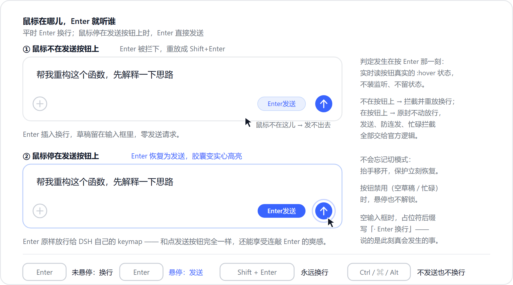

# dsh-no-enter-send · 屏蔽 Enter 发送，悬停在发送按钮时解锁

一个只做一件事的 DeepSeek Harness Web 插件：**平时 Enter 不发送，鼠标停在发送按钮上时 Enter 才发送**。

[](https://www.npmjs.com/package/dsh-no-enter-send)
[](LICENSE)

- **平时 Enter 换行**：不碰鼠标时按 Enter 就是换行，写长 prompt、贴代码、输入法选词都不会误发。
- **悬停即解锁**：鼠标移到发送按钮上，Enter 立刻恢复成「发送」——想连着敲 Enter 发送时，手不用离开键盘。
- **提示就在按钮旁**：发送按钮左侧常驻一枚高亮胶囊「Enter发送」，鼠标悬上去时它变成实心蓝底，明确告诉你「现在 Enter 能发了」。输入框为空时，占位符后缀显示「Enter 换行」。



## 为什么需要它

DSH 的输入框默认是 Enter 发送、Shift+Enter 换行。写长 prompt、贴代码、或者在中文输入法里选词时，误按 Enter 会直接把没写完的内容发出去。

但「彻底禁用 Enter 发送」也有代价：真要发送时得把手从键盘挪到鼠标上。这个插件的折中是——**鼠标在哪儿，Enter 就听谁**：

- 鼠标不在发送按钮上 → Enter 是换行键，误发不可能发生；
- 鼠标停在发送按钮上 → Enter 是发送键，享受敲 Enter 发出去的爽感。

因为判定发生在按键那一刻、依据是按钮真实的 `:hover` 状态，所以不存在「忘了切模式」的问题：抬手移开鼠标，保护立刻恢复。

## 行为细节

| 操作 | 结果 |
| --- | --- |
| `Enter`（鼠标**不在**发送按钮上） | 换行 |
| `Enter`（鼠标**停在**发送按钮上） | **发送**，等同于点击发送按钮 |
| `Shift` + `Enter` | 换行（悬停时也一样） |
| `Ctrl` / `Cmd` + `Enter`（悬停时） | 交给 DSH 原生逻辑（运行中发送即插队/引导） |
| `Ctrl` / `Cmd` / `Alt` + `Enter`（未悬停） | 被吞掉，既不发送也不换行 |
| 小键盘 `Enter` | 同上两条规则 |
| 输入法组字中按 `Enter` | 交给输入法选词，不拦截 |
| `/`、`@`、命令菜单打开时按 `Enter` | 照常选中菜单项（悬停也不例外） |
| 发送按钮被禁用时（空输入框、上传中、忙碌） | 悬停不解锁，`Enter` 仍是换行 |
| 输入框以外的 `Enter`（对话框、重命名、按钮） | 完全不受影响 |
| 点击发送按钮 | 正常发送 |

## 安装

从 npm 安装（推荐）：

```bash
dsh plugin add dsh-no-enter-send
```

或者在会话里直接让 agent 装：

```
plugin_manager({ action: 'install_bundle', target: 'dsh-no-enter-send' })
```

工作区里有源码时，也可以指向本地目录：

```
plugin_manager({ action: 'install_bundle', target: '<本目录绝对路径>' })
```

安装后刷新 Harness Web 页面即可生效；在「设置 → 插件」里能看到「屏蔽 Enter 发送」。

## 开发

```bash
npm test    # node test/harness.cjs —— 离线假 DOM 测试，不需要浏览器
npm run check   # node --check client.js
```

`test/harness.cjs` 用一个极小的假 DOM 把 `client.js` 跑在 `vm` 沙箱里，断言的核心契约是：未悬停时 Enter 一定被 `preventDefault` 且不会到达编辑器的发送逻辑、Enter 一定以 Shift+Enter 重放从而产生换行、悬停时 Enter 一定原样放行（且不重放）、悬停但按钮禁用时不解锁、组字与菜单场景一定放行、输入框之外的 Enter 一定不受影响、卸载后行为完全恢复。

## 实现要点

- **捕获阶段拦截**。输入框是 Lexical 编辑器，`KEY_ENTER_COMMAND` 在 contenteditable 根节点（冒泡阶段）处理，外壳的快捷键服务更靠上。插件在 `window` 上以 capture 阶段监听 `keydown`，先于两者运行，用一次 `preventDefault() + stopImmediatePropagation()` 就掐断了所有键盘发送路径，不必逐个追 handler。
- **悬停解锁 = 什么都不做**。判定「鼠标是否停在发送按钮上」用 `button.matches(':hover')`，在 keydown 那一刻实时计算，没有监听器、没有状态、不会变脏。一旦成立就直接 `return`，把事件**原封不动**放行给 DSH 自己的 keymap——于是 Enter 发送、Shift+Enter 换行、`:repeat` 防连发、忙碌时 `canSubmit()` 拦截全部由官方逻辑负责，插件不需要知道发送是怎么实现的。
- **Enter 重放成 Shift+Enter**。未悬停时，DSH 的 Enter 处理器对 shift 组合返回 `false`，于是 Lexical 插入换行节点。插件用一个 `synthetic` 标志跳过自己重放的那一次，避免自噬。
- **按钮靠语义特征识别，不靠类名**。发送按钮没有专属 `data-*`，稳定特征是「卡片内、带 `aria-busy`、不带 `aria-haspopup` 的 `<button>`」：`[data-composer-card] button[aria-busy]:not([aria-haspopup])`。停止按钮没有 `aria-busy`，模型选择器带 `aria-haspopup="menu"`，因此唯一命中。CSS Modules 的哈希类名一个都没用到。
- **军械态用纯 CSS 联动**。提示胶囊本身在原地；「已武装」的外观由 `[data-composer-card]:has(button[aria-busy]:not([aria-haspopup]):not(:disabled):hover) .dsnes-hint` 驱动，不需要 JS 参与，鼠标移开自动复原。
- **只拦截编辑器区域**。事件目标先做 `closest('[data-composer-input]')`；如果目标是 `body`/`documentElement`（键盘事件没有落点时），退回用 `document.activeElement` 判断。因此对话框、重命名框、按钮上的 Enter 全部保持原生行为。
- **提示用两处，互不抢位**。输入框为空时，在 DSH 自己的占位符节点上挂 `::after` 显示「 · Enter 换行」——说的是此刻（草稿为空、发不出去）真正会发生的事；发送按钮左侧的常驻胶囊「Enter发送」负责说明另一件事。两处文案都用 `:lang(zh)` 双规则，切换语言时即时跟随。
- **不碰哈希类名**。只使用稳定的 `data-composer-*` 属性、`:has()` 与 `--dsw-*` 主题变量，Harness 升级重排样式也不会失效。

## 文件

```
client.js           浏览器端全部实现（拦截 + 换行 + 悬停解锁 + 提示 + 样式）
index.js            host 半边，空实现（插件纯前端）
cordis.patch.yml    bundle patch，向组合插入本插件
locale/zh.json      中文标题与描述
locale/en.json      English title and description
icon.svg            图标
docs/preview.svg    行为示意图（源文件）
docs/preview.png    行为示意图（渲染结果，README 里引用）
test/harness.cjs    离线测试
```

## 关于旧名

这个包最初发布时叫 `dsh-no-enter-sand`（sand = 沙子），是拼写错误，正确单词是 **send**（发送）。现已改名为 `dsh-no-enter-send`：

- 旧包 `dsh-no-enter-sand` 已弃用（deprecated），`npm i dsh-no-enter-sand` 会提示改用新包。
- 旧仓库地址 `github.com/pokereva/dsh-no-enter-sand` 会自动 301 跳转到新仓库，commit 历史与 release 完整保留。
- 只有包名变了，**功能、入口、bundle 名字段全部一致**，插件行为不受影响。

## 兼容性

在 **DSH 0.2.2-rc.1** 与 **0.2.2-rc.3** 上实测通过。插件只依赖四样稳定契约，它们在 rc.1 → rc.3 之间未发生变化：

- `data-composer-input`（Lexical 的 contenteditable 根节点）与 `data-composer-placeholder`（占位符层）两个属性；
- `data-composer-card` 卡片容器 + 发送按钮的 `aria-busy` / `aria-haspopup` 语义（用于识别按钮与驱动 `:has()` 样式）；
- `conversation.input.right` 槽位（`ctx.slots.register({ name, id, order }, Component)`）；
- `dsh.bundle.patch` + `dsh.client`（`platform: 'web'`、`inject`、`immediately`、`exports["./client"]`）包清单。

rc.3 上的实测结果（CDP 驱动真实指针与键盘）：

| 场景 | 结果 |
| --- | --- |
| 未悬停按 `Enter` | 插入换行，零网络请求 |
| 悬停发送按钮后按 `Enter` | 发出消息（`POST /api/session/prompt`），输入框清空 |
| 悬停时按 `Shift+Enter` | 仍插入换行，零网络请求 |
| 移开鼠标后按 `Enter` | 恢复为换行，零网络请求 |
| 提示胶囊 | 平时淡蓝底蓝字，悬停变实心蓝底白字，移开自动复原 |
| 语言 | `<html lang="zh-CN">` 显示「Enter发送」，`en` 显示「Enter to send」 |

不依赖哈希类名，也不依赖 composer 的内部实现，因此小版本升级通常无需改动。

**命令菜单是例外**：输入 `/` 或 `@` 唤出的补全菜单打开时，插件会把 `Enter` 原样交给菜单（用于选中高亮项或补全），而不是插换行——即使鼠标正停在发送按钮上也是如此，否则菜单会「点不动」。实测 rc.3 上输入 `/plan` 后按 `Enter` 会补全成 `/计划 ` 而不是发送。菜单收起后规则立即恢复。

## 许可

MIT
